  

  

    
<strong><big>🐾 Shan-Mao</big></strong>

    
  

---

---

<picture>
  <source
    media="(prefers-color-scheme: dark)"
    srcset="https://raw.githubusercontent.com/Shan-Mao/Shan-Mao/main/dist/isocat.svg">
  <source
    media="(prefers-color-scheme: light)"
    srcset="https://raw.githubusercontent.com/Shan-Mao/Shan-Mao/main/dist/isocat-light.svg">
  
</picture>
