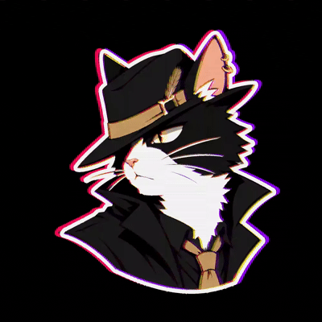

# 🐾 Shan-Mao

### 一只喜欢 Minecraft 的山猫

---

<table>
  <tr>
    <td width="40%" valign="top">
      
    </td>
    <td width="60%" valign="top">
      <h3>SYSTEM DASHBOARD</h3>
      
AI · R · Python · TypeScript

      

        <code>VISUAL SKILL STUDIO</code> 
        <code>SHAN-MAO BLOG</code>
      

    </td>
  </tr>
</table>

---

<picture>
  <source
    media="(prefers-color-scheme: dark)"
    srcset="https://raw.githubusercontent.com/Shan-Mao/Shan-Mao/main/dist/isocat.svg">
  <source
    media="(prefers-color-scheme: light)"
    srcset="https://raw.githubusercontent.com/Shan-Mao/Shan-Mao/main/dist/isocat-light.svg">
  
</picture>
